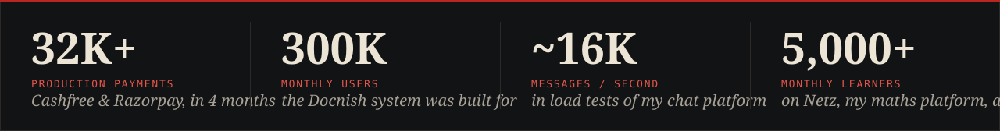
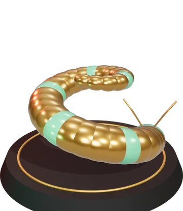
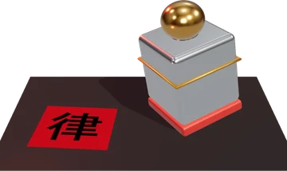
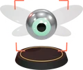
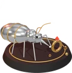
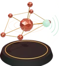

<picture>
  <source media="(prefers-color-scheme: dark)" srcset="assets/banner-dark.svg">
  <source media="(prefers-color-scheme: light)" srcset="assets/banner-light.svg">
  
</picture>

<p align="center">
  
</p>

<p align="center">
  <a href="https://portfolio-five-navy-sdnb8nj53u.vercel.app"></a>
  <a href="https://www.linkedin.com/in/suleman-khan-b4ab2b275"></a>
  <a href="mailto:sulaimanclass12b@gmail.com"></a>
  <a href="https://portfolio-five-navy-sdnb8nj53u.vercel.app/resume_sulaiman.pdf"></a>
  
</p>

## About me

I'm a **backend software engineer** at **Techdock Labs** in Lucknow, India. I design and run the parts of a product people only notice when they break: real-time messaging, payment flows, background queues, and the CI/CD and monitoring that keep them shipping.

Before Techdock I joined **Docnish** as an intern, was hired full-time, and went on to co-lead engineering across nine production products, including the payment infrastructure behind **32K+ real payments in four months**.

```ts
const sulaiman = {
  role:      "Backend Software Engineer",
  company:   "Techdock Labs",
  location:  "Lucknow, India",
  focus:     ["Distributed & real-time systems", "Payment infrastructure", "Event-driven queues", "DevOps & observability"],
  building:  ["Myriad Voices — chat that survives without the internet", "Netz v2", "PactDoc"],
  education: "BCA, Integral University (2023–2026)",
  openTo:    "Backend / platform engineering roles",
};
```

<picture>
  <source media="(prefers-color-scheme: dark)" srcset="assets/stats-dark.svg">
  <source media="(prefers-color-scheme: light)" srcset="assets/stats-light.svg">
  
</picture>

## Tech stack

<table>
  <tr>
    <td><b>Languages</b></td>
    <td>      </td>
  </tr>
  <tr>
    <td><b>Backend</b></td>
    <td>     </td>
  </tr>
  <tr>
    <td><b>Real-time & queues</b></td>
    <td>    </td>
  </tr>
  <tr>
    <td><b>Databases</b></td>
    <td>     </td>
  </tr>
  <tr>
    <td><b>DevOps & cloud</b></td>
    <td>       </td>
  </tr>
  <tr>
    <td><b>Frontend</b></td>
    <td>        </td>
  </tr>
  <tr>
    <td><b>Mobile & desktop</b></td>
    <td>  </td>
  </tr>
  <tr>
    <td><b>AI / ML</b></td>
    <td>   </td>
  </tr>
  <tr>
    <td><b>Testing & performance</b></td>
    <td>     </td>
  </tr>
  <tr>
    <td><b>Payments</b></td>
    <td> </td>
  </tr>
</table>

## Featured projects

<table>
  <tr>
    <td width="180" align="center"></td>
    <td>
      <b><a href="https://github.com/sulaimankhan8/demo-discord">Myriad Voices</a></b> — distributed real-time chat, voice and video, with an offline Bluetooth mesh<br>
      <sub>LIVE · WEB · ANDROID · iOS · WINDOWS</sub><br><br>
      • Socket.IO scaled horizontally with Redis Pub/Sub; Redis Streams as a write-ahead log; BullMQ workers with a dead-letter queue<br>
      • <b>~16K messages/sec</b> sustained in Artillery load tests<br>
      • Mediasoup SFU for voice and video with active-speaker detection<br>
      • When the internet drops, signed messages hop phone to phone over Bluetooth (up to 7 hops), end-to-end encrypted (X25519 + XChaCha20-Poly1305)<br>
      • One Next.js codebase ships as the website, Android and iOS apps (Capacitor) and a ~14 MB Windows app (Wails + Go)<br><br>
      <a href="https://demo-discord-seven.vercel.app/">Live demo</a> · <a href="https://portfolio-five-navy-sdnb8nj53u.vercel.app/gu/myriad-voices">Case study</a>
    </td>
  </tr>
  <tr>
    <td width="180" align="center"></td>
    <td>
      <b><a href="https://github.com/sulaimankhan8/Netz">Netz</a></b> — interactive platform for learning numerical methods<br>
      <sub>LIVE · FOUNDER · SINCE AUG 2024</sub><br><br>
      • <b>5,000+ monthly users</b> at its peak, built and run solo<br>
      • 34 solvers (Bisection, Gauss-Seidel, Newton-Raphson…) with step-by-step working, iteration tables and plots<br>
      • Whiteboard that reads handwritten maths using three on-device ONNX models<br>
      • Notes with live solver blocks, daily tasks and streaks synced to accounts; installable PWA<br><br>
      <a href="https://netz-ruby.vercel.app/">Live site</a> · <a href="https://portfolio-five-navy-sdnb8nj53u.vercel.app/gu/numeral-insight">Case study</a>
    </td>
  </tr>
  <tr>
    <td width="180" align="center"></td>
    <td>
      <b><a href="https://github.com/sulaimankhan8/Signaturly">PactDoc</a></b> (formerly Signaturly) — e-signature and document workflow, built India-first<br>
      <sub>IN DEVELOPMENT · PRE-LAUNCH</sub><br><br>
      • Sealed PDFs and a chained audit log of who signed what, and when<br>
      • Team workspaces with roles, public API with keys and webhooks, Razorpay billing, signing in English and Hindi<br>
      • 525 server tests and 56 browser tests; the server refuses to boot if any secret is missing<br><br>
      <a href="https://portfolio-five-navy-sdnb8nj53u.vercel.app/gu/blood-seal">Case study</a>
    </td>
  </tr>
</table>

<details>
<summary><b>More projects</b></summary>
<br>

| | Project | What it does |
|:-:|---|---|
|  | [**Smart Traffic Intelligence**](https://github.com/sulaimankhan8/smart_traffic) | YOLOv8 vehicle, helmet and accident detection over FastAPI; congestion scores for adaptive signals; STGCN and DCRNN traffic forecasting |
|  | **Jewellery price scraper** | Benchmarked on 30 Indian jewellery sites: 20 full extractions, ~1.85 s average, zero crashes |
|  | **RAG conflict resolver** | Retrieves evidence from chat history to settle disputes with grounded answers instead of made-up ones |
|  | [**BLE emergency-vehicle mesh**](https://github.com/sulaimankhan8/Ble-Backend) | Backend, [dashboard](https://github.com/sulaimankhan8/Ble-Dashbord) and [PWA](https://github.com/sulaimankhan8/Ble-pwa) for Bluetooth-assisted emergency-vehicle priority where the network drops out |
|  | [**Web-novel scraper**](https://github.com/sulaimankhan8/scrapingNovelsCauseUnemployed) | Scrapes, retries and cleans whole novels into a reading archive |
|  | **Gaussian elimination extension** | Solves linear systems from the browser toolbar — the seed that grew into Netz |

</details>

## Experience

**Backend Developer · Techdock Labs** <sub>Apr 2026 – present</sub><br>
- Backend systems for several production apps, including a creator collaboration platform
- Designed and maintain the CI/CD pipelines, Docker deployments, production monitoring and analytics
- Backend architecture, API design, deployment automation and performance work

**Full-stack Developer & Project Co-Lead · Docnish** <sub>Jun 2025 – Dec 2025 · intern → full-time</sub><br>
- Architected the backend and frontend from scratch
- Designed the Cashfree and Razorpay payment infrastructure: **32K+ production payments in four months**
- Co-led engineering across nine products: booking, CRM, CMS, recommendations, search and orders
- Built for 5,000+ concurrent and 300K monthly users; load, unit and E2E tested; Docker, GitHub Actions, AWS

## Currently

- Adding forward secrecy (Noise XX handshake) to Myriad Voices' direct messages
- Switching on Google sign-in and Pro plans for Netz
- Taking PactDoc through its last production checks before launch

## Achievements

- Co-founder of **Binary Battalions**, the coding club of the Computer Applications department at Integral University
- **Top 5**, Smart India Hackathon 2025 (internal round), as team lead
- **Semi-finalist**, HackFiesta 6.0 at IIIT Lucknow, as team lead
- Organiser and question setter, **Integral Prompt War 1.0**

<p align="center"><sub>Banner and project art from <a href="https://portfolio-five-navy-sdnb8nj53u.vercel.app">my portfolio</a>, rendered in three.js.</sub></p>
